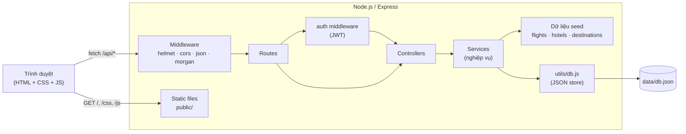
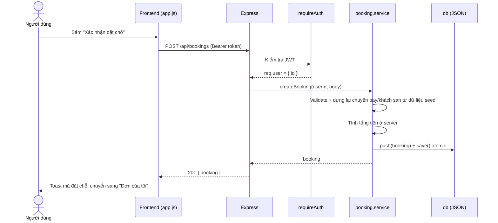

# Kiến trúc hệ thống — TravelGo

## 1. Tổng quan

TravelGo là ứng dụng web đơn khối (monolith): một tiến trình Node.js/Express vừa phục vụ **REST API** (`/api/*`) vừa phục vụ **frontend tĩnh** (thư mục `public/`). Cách này giúp chạy bằng một lệnh, không phải cấu hình CORS hay deploy hai dịch vụ.



## 2. Các tầng và trách nhiệm

| Tầng | Thư mục | Trách nhiệm | Không được làm |
| --- | --- | --- | --- |
| Routes | `src/routes` | Khai báo URL, gắn middleware (auth, rate limit) | Chứa logic nghiệp vụ |
| Controllers | `src/controllers` | Đọc `req`, gọi service, trả `res` | Truy cập dữ liệu trực tiếp |
| Services | `src/services` | Validate nghiệp vụ, tính giá, thao tác dữ liệu | Biết về `req`/`res` |
| Utils | `src/utils` | Validator, `HttpError`, kho dữ liệu JSON | Chứa nghiệp vụ |
| Middleware | `src/middleware` | Xác thực JWT, xử lý lỗi tập trung | — |
| Config | `src/config` | Đọc và kiểm tra biến môi trường | — |

Quy tắc phụ thuộc: `routes → controllers → services → utils`. Tầng dưới không `require` tầng trên, nên có thể test service độc lập và thay kho dữ liệu mà không đụng controller.

## 3. Luồng xử lý một yêu cầu đặt chỗ



## 4. Quyết định thiết kế

| Quyết định | Lý do | Đánh đổi |
| --- | --- | --- |
| Lưu trữ file JSON thay vì database | Không cần cài đặt, giảng viên/người chấm chạy được ngay | Không phù hợp tải lớn, ghi đồng thời nhiều tiến trình. Giao diện `collection()/save()` giúp thay bằng DB thật sau này |
| Chuyến bay **sinh theo quy tắc** từ tuyến, hãng, khung giờ, ngày | Không cần lưu hàng nghìn chuyến; kết quả ổn định (cùng truy vấn → cùng kết quả) | Không có tồn kho chỗ ngồi thật; `seatsLeft` là giá trị mô phỏng ổn định |
| Server **tính lại giá** khi đặt | Không tin dữ liệu từ client, tránh sửa giá | Phải dựng lại chuyến bay từ `flightId` + `date` |
| JWT trong `localStorage` | Đơn giản cho SPA thuần | Rủi ro XSS cao hơn cookie `HttpOnly`; đã giảm bằng CSP của `helmet` và escape khi render |
| Frontend JS thuần | Không cần bước build, ít phụ thuộc | Phải tự quản lý render; nếu mở rộng nên chuyển React/Vue |
| `node:test` thay Jest | Có sẵn trong Node, không thêm dependency | Ít tính năng mock/coverage hơn |
| Test dùng `fetch` + `listen(0)` | Không cần `supertest`, cổng ngẫu nhiên không đụng nhau | — |

## 5. Bảo mật

- **Mật khẩu:** băm bằng `bcryptjs` (cost 10), không lưu bản rõ, không trả về API.
- **Xác thực:** JWT ký bằng `JWT_SECRET`, hết hạn theo `JWT_EXPIRES_IN`. Ở môi trường `production` server từ chối khởi động nếu dùng secret mặc định.
- **Phân quyền dữ liệu:** mọi thao tác trên đơn đặt kiểm tra `booking.userId === req.user.id` (trả 403 nếu sai).
- **Header bảo mật:** `helmet` (CSP, X-Content-Type-Options, …). Frontend không dùng script/handler inline nên tương thích CSP mặc định.
- **XSS:** mọi dữ liệu chèn vào HTML đều qua hàm `esc()`.
- **Brute-force:** `express-rate-limit` cho `/auth/register` và `/auth/login`.
- **Đầu vào:** validate kiểu, độ dài, định dạng ngày, phạm vi số ở tầng service; giới hạn body JSON 100 KB.
- **Thông báo lỗi đăng nhập** không cho biết email có tồn tại hay không.

## 6. Xử lý lỗi

Mọi lỗi nghiệp vụ ném `HttpError(status, message)`. `errorHandler` chuyển thành JSON thống nhất:

```json
{ "error": { "message": "Email đã được đăng ký" } }
```

Lỗi không lường trước trả `500` với thông báo chung và chỉ ghi chi tiết ra log của server.

## 7. Khả năng mở rộng

1. **Database thật:** viết lại `utils/db.js` (hoặc thêm repository) cho MongoDB/PostgreSQL; các service giữ nguyên giao diện.
2. **Tách frontend:** `public/` có thể chuyển sang React/Vue riêng, chỉ cần cấu hình `CORS_ORIGINS`.
3. **Thanh toán thật:** thêm `payment.service` và webhook xác nhận, đơn chuyển trạng thái `pending → confirmed`.
4. **Nhiều tiến trình:** thay kho JSON bằng DB để tránh ghi đè giữa các instance.
