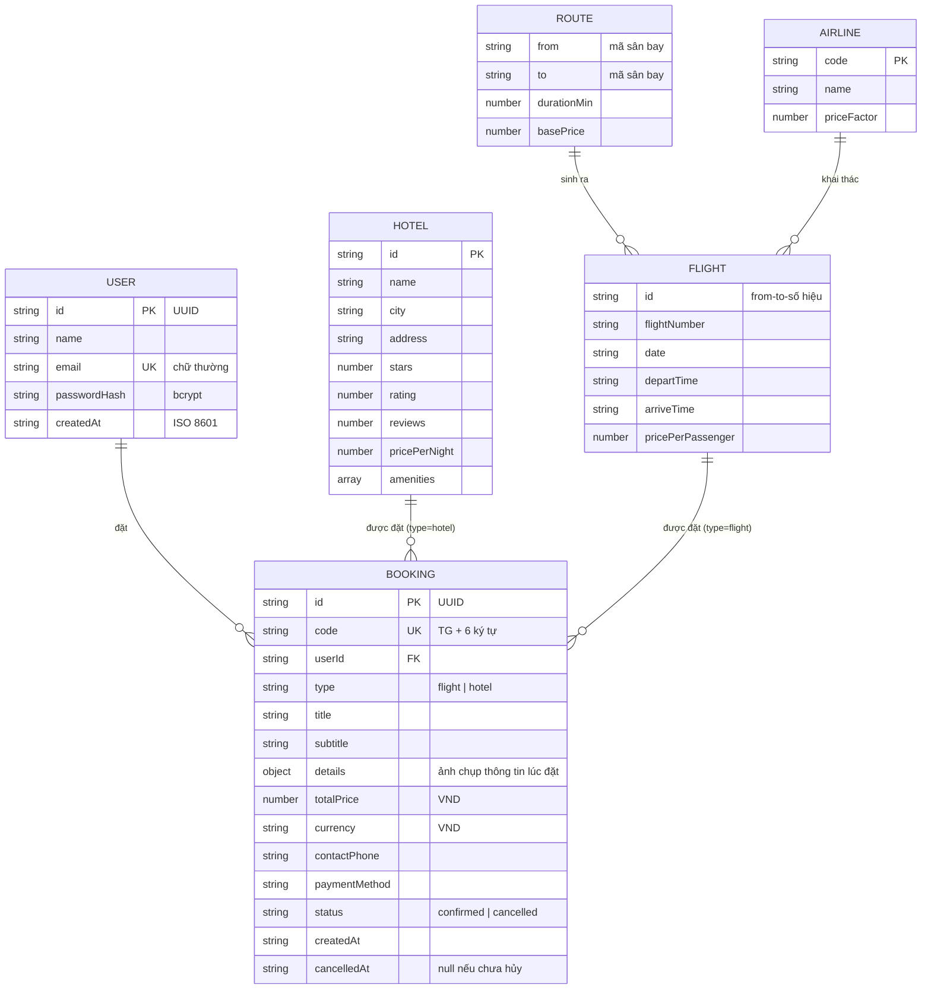

# Mô hình dữ liệu — TravelGo

## 1. Tổng quan lưu trữ

| Loại dữ liệu | Nơi lưu | Ghi chú |
| --- | --- | --- |
| Dữ liệu **động** (người dùng, đơn đặt) | `data/db.json` (đường dẫn đổi bằng `DB_FILE`) | Tạo tự động ở lần ghi đầu tiên, không đưa lên Git |
| Dữ liệu **tĩnh** (sân bay, hãng, tuyến, khách sạn, điểm đến) | `src/data/*.json` | Có trong Git, đóng vai trò dữ liệu seed |
| Chuyến bay | **Không lưu** — sinh theo quy tắc | Từ tuyến × hãng × khung giờ × ngày |

## 2. Sơ đồ quan hệ (ERD)



`FLIGHT` là thực thể ảo (không lưu), được dựng lại từ `flightId` + `date` mỗi khi cần.

## 3. Chi tiết collection động

### 3.1 `users`

| Trường | Kiểu | Ràng buộc |
| --- | --- | --- |
| `id` | string (UUID v4) | Khóa chính |
| `name` | string | 2–60 ký tự |
| `email` | string | Duy nhất, lưu chữ thường, tối đa 120 ký tự |
| `passwordHash` | string | bcrypt, **không bao giờ trả về qua API** |
| `createdAt` | string | ISO 8601 |

### 3.2 `bookings`

| Trường | Kiểu | Ràng buộc |
| --- | --- | --- |
| `id` | string (UUID v4) | Khóa chính |
| `code` | string | `TG` + 6 ký tự từ bảng chữ không gây nhầm lẫn (bỏ `0 O 1 I`) |
| `userId` | string | Tham chiếu `users.id` |
| `type` | `"flight"` \| `"hotel"` | |
| `title`, `subtitle` | string | Chuỗi hiển thị |
| `details` | object | Với vé: `{ flight, passengers[] }`. Với phòng: `{ hotel, checkIn, checkOut, nights, rooms, guests, guestName, pricePerNight }` |
| `totalPrice` | integer | VND, tính ở server |
| `contactPhone` | string | 8–15 ký tự gồm số, `+`, khoảng trắng, `-` |
| `paymentMethod` | enum | `card`, `bank_transfer`, `e_wallet`, `pay_at_property` |
| `status` | enum | `confirmed` → `cancelled` (một chiều) |
| `createdAt`, `cancelledAt` | string | ISO 8601 / `null` |

`details` lưu **ảnh chụp** thông tin tại thời điểm đặt, vì vậy việc đổi giá hay tên khách sạn sau này không làm sai lệch đơn cũ.

Ví dụ `data/db.json`:

```json
{
  "users": [
    { "id": "…", "name": "Nguyễn Văn A", "email": "a@example.com",
      "passwordHash": "$2a$10$…", "createdAt": "2026-11-08T06:30:00.000Z" }
  ],
  "bookings": [
    { "id": "…", "code": "TGK7M2QX", "userId": "…", "type": "hotel", "status": "confirmed" }
  ]
}
```

## 4. Quy tắc sinh chuyến bay

Với mỗi yêu cầu `(from, to, date)`:

1. Tìm tuyến trong `flights.json` (khớp cả hai chiều).
2. Với mỗi hãng × mỗi khung giờ (bỏ 1/4 tổ hợp để kết quả đa dạng) tạo một chuyến.
3. Giờ đến = giờ đi + `durationMin`; nếu qua nửa đêm đặt `arriveDayOffset`.
4. Giá = `basePrice × priceFactor × hệ số ngày`, làm tròn 1.000 ₫ (hệ số ngày: Chủ nhật 1.10, thứ Sáu 1.05, thứ Bảy 1.10, còn lại 1.00).
5. `seatsLeft` được suy ra từ hàm băm của `(số hiệu, ngày)` nên **ổn định** giữa các lần gọi.

## 5. Nâng cấp lên database thật

Tầng dữ liệu hiện chỉ gồm `collection(name)` và `save()`. Để chuyển sang MongoDB hoặc PostgreSQL:

1. Tạo repository (`userRepository`, `bookingRepository`) với các hàm `findByEmail`, `insert`, `findByUser`, `update`.
2. Thay các lời gọi `db.collection(...)` trong `auth.service.js` và `booking.service.js` bằng repository.
3. Thêm chỉ mục: `users.email` (unique), `bookings.userId`, `bookings.code` (unique).
4. Thêm biến môi trường kết nối (`DATABASE_URL`) vào `.env.example` và `config`.

Gợi ý bảng PostgreSQL:

```sql
CREATE TABLE users (
  id UUID PRIMARY KEY,
  name VARCHAR(60) NOT NULL,
  email VARCHAR(120) NOT NULL UNIQUE,
  password_hash TEXT NOT NULL,
  created_at TIMESTAMPTZ NOT NULL DEFAULT now()
);

CREATE TABLE bookings (
  id UUID PRIMARY KEY,
  code CHAR(8) NOT NULL UNIQUE,
  user_id UUID NOT NULL REFERENCES users(id),
  type VARCHAR(10) NOT NULL CHECK (type IN ('flight','hotel')),
  title TEXT NOT NULL,
  subtitle TEXT NOT NULL,
  details JSONB NOT NULL,
  total_price BIGINT NOT NULL CHECK (total_price >= 0),
  currency CHAR(3) NOT NULL DEFAULT 'VND',
  contact_phone VARCHAR(15) NOT NULL,
  payment_method VARCHAR(20) NOT NULL,
  status VARCHAR(10) NOT NULL DEFAULT 'confirmed' CHECK (status IN ('confirmed','cancelled')),
  created_at TIMESTAMPTZ NOT NULL DEFAULT now(),
  cancelled_at TIMESTAMPTZ
);
CREATE INDEX idx_bookings_user ON bookings(user_id, created_at DESC);
```
